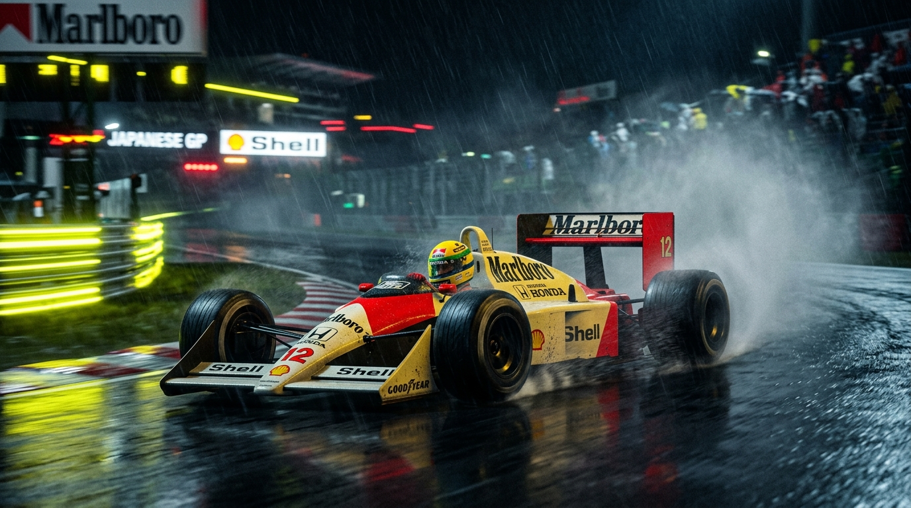

# 🏎️ Ayrton Senna — O Doido da Velocidade & A Lenda da F1

> Landing page moderna, responsiva e de alta performance dedicada à lenda do automobilismo mundial **Ayrton Senna da Silva**, inspirada na estética minimalista e no design do site oficial do piloto Lando Norris.



---

## 🌟 Recursos e Destaques

- **🏎️ Estética & Identidade Visual de Alta Velocidade**:
  - Paleta de cores lendária: Amarelo Capacete (`#FFE100`), Verde Brasil (`#009B3A`), Azul Brasil (`#002776`) e um *Dark Mode Premium* (`#0A0A0C`).
  - Cards com efeito *Glassmorphism* (`backdrop-blur`), bordas brilhantes em hover e micro-interações dinâmicas.
  - Animações fluidas no scroll e no carregamento via **Framer Motion**.
  
- **📊 Contador de Estatísticas da Carreira**:
  - **3x** Campeão Mundial de F1 (1988, 1990, 1991).
  - **41** Vitórias em Grandes Prêmios.
  - **65** Pole Positions.
  - **80** Pódios na elite do automobilismo.

- **⏳ Linha do Tempo Interativa**:
  - Navegue por todas as fases históricas: *Kart & Origens (1973-1983)*, *Toleman & Lotus (1984-1987)*, *A Era Ouro na McLaren (1988-1993)* e *Legado Eterno (1994-Presente)*.

- **🏎️ Garagem & Ficha Técnica (Capacetes e Carros)**:
  - Grid interativo com filtros por categoria (*Carros Lendários*, *Capacetes Icônicos*, *Corridas Épicas*).
  - Modal interativo detalhando especificações do **McLaren MP4/4**, **Lotus 97T**, **MP4/6** e o lendário **Capacete Amarelo** pintado por Sid Mosca.

- **💬 Carrossel de Citações Marcantes**:
  - Frases célebres de Senna sobre dedicação, superação, fé e busca pelo limite com transições automáticas.

- **💛 Legado & Instituto Ayrton Senna**:
  - Seção dedicada ao trabalho educacional que já impactou mais de 36 milhões de crianças no Brasil, com acionador de doação e efeitos visuais.

---

## 🛠️ Tecnologias Utilizadas

- **Framework**: [Next.js 15](https://nextjs.org/) (App Router)
- **Biblioteca de UI**: [React 19](https://react.dev/)
- **Linguagem**: [TypeScript](https://www.typescriptlang.org/)
- **Estilização**: [Tailwind CSS](https://tailwindcss.com/)
- **Animações**: [Framer Motion](https://www.framer.com/motion/)
- **Ícones**: [Lucide React](https://lucide.dev/)
- **Efeitos Especial**: [Canvas Confetti](https://www.npmjs.com/package/canvas-confetti)

---

## 🚀 Como Rodar o Projeto Localmente

### Pré-requisitos
- **Node.js** v18.0.0 ou superior
- **npm** ou **yarn** / **pnpm**

### Passo a Passo

1. **Clonar o Repositório**:
   ```bash
   git clone https://github.com/SEU-USUARIO/senna-landing-page.git
   cd senna-landing-page
   ```

2. **Instalar as Dependências**:
   ```bash
   npm install
   ```

3. **Executar o Servidor de Desenvolvimento**:
   ```bash
   npm run dev
   ```

4. **Acessar no Navegador**:
   Abra [http://localhost:3000](http://localhost:3000) no seu navegador para ver o resultado em tempo real.

5. **Gerar a Build de Produção**:
   ```bash
   npm run build
   npm run start
   ```

---

## 📁 Estrutura de Arquivos

```text
Senna/
├── public/
│   └── images/               # Fotos e imagens de alta qualidade
├── src/
│   ├── app/
│   │   ├── globals.css       # Estilos globais e tokens do Tailwind
│   │   ├── layout.tsx        # Layout raiz e configurações de SEO
│   │   └── page.tsx          # Página principal
│   └── components/
│       ├── Navbar.tsx        # Navegação com o logo "S do Senna"
│       ├── Hero.tsx          # Seção inicial de impacto
│       ├── StatsCounter.tsx  # Cards das estatísticas animadas
│       ├── Timeline.tsx      # Linha do tempo interativa por abas
│       ├── CarsAndHelmets.tsx # Grid da garagem com modal técnico
│       ├── QuoteSlider.tsx   # Carrossel de citações inspiradoras
│       ├── InstitutoSenna.tsx# Seção sobre o legado social
│       └── Footer.tsx        # Rodapé e links oficiais
├── tailwind.config.ts        # Configuração do Tailwind CSS
├── tsconfig.json             # Configuração do TypeScript
└── package.json              # Dependências e scripts do projeto
```

---

## 🇧🇷 Tributo & Licença

Projeto desenvolvido como uma homenagem ao tricampeão mundial de Fórmula 1 **Ayrton Senna da Silva**.  
#SennaSempre 🇧🇷
